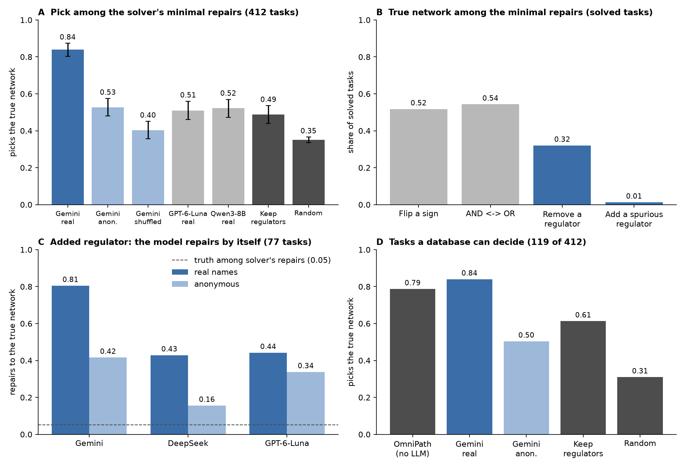
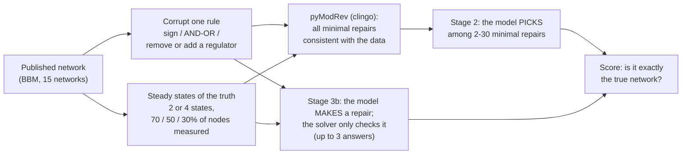

# Can a language model pick, or make, the right repair? Knowledge-guided revision of Boolean network models

**Summary.** When a logical model of a gene-regulatory or signalling network contradicts experimental data, a logic
solver can list every *minimal* way to fix it. Often several fixes fit the data equally well, and sometimes the true
fix is not minimal at all. This project builds a benchmark from 15 published Boolean networks and asks two
questions: can a large language model **pick** the true repair among the solver's equally minimal ones, and can it
**make** a repair the solver never proposes? Name-swapping controls test whether biological knowledge, rather than
a shortcut, does the work; a curated interaction database (OmniPath) tests whether a language model is needed for
that knowledge at all.

Status: **complete as a portfolio project (v0.3, November 2026).** All numbers below come from the code and tables in
this repository. It was not developed into a paper; the open points are listed under [Limitations](#limitations).



*A: picking among the solver's minimal repairs (412 tasks; bars 95% CI). B: how often the true network is among the
minimal repairs, by kind of error. C: for an added (spurious) regulator, the model repairs the network itself; dashed
line: share of tasks whose truth is among the solver's repairs. D: on the tasks a curated database can decide.
Script: `scripts/make_summary_figure.py`.*

## Main findings

1. **Biological knowledge helps a strong model pick the right repair.** On 412 ambiguous tasks Gemini 3.8 Flash
   with real gene names picks the true network in 84% (95% CI 80–87%), 35 points above the best rule without AI
   (CI 29–41). With anonymous names it falls to that rule's level; with names shuffled between nodes it falls
   below the anonymous condition (−0.12, CI −0.18 to −0.07). A local 8B model and GPT-6-Luna show little of this.
2. **The minimal-change principle has a blind spot.** If an error *adds* a spurious regulator, the true network is
   among pyModRev's minimal repairs in 1% of solved tasks (4 of 314), against 52–54% for sign or AND/OR errors.
   No chooser can fix this.
3. **Language models can repair inside that blind spot.** Told only that one rule is wrong and allowed to edit
   rules themselves (the solver only checks consistency), all three models tested beat the solver's ceiling on
   added-regulator tasks; Gemini with real names recovers the true network in 81% of 77 tasks (+0.75 over the
   ceiling, CI 0.66–0.84).
4. **Free repair complements the solver, it does not replace it.** On removed-regulator tasks and on the original
   tasks, repairing alone is worse than the solver's list; within one model (GPT-6-Luna, 151 tasks) repairing is
   17 points below picking (CI −28 to −6).
5. **Where a curated database has the facts, it does about as well as Gemini.** On the 119 tasks OmniPath can
   decide, OmniPath picks correctly in 79%, Gemini in 84% (difference +0.05, CI −0.05 to 0.15). Gemini's overall
   lead comes mainly from coverage: species and nodes the database does not cover.
6. **Single answers are noisy.** On added-regulator and original tasks GPT-6-Luna (no temperature control) gave the
   same outcome in all three answers for only about a third to a half of tasks, although group accuracies were
   stable across repeats.

## How a task is built



1. **Truth.** A published, curated Boolean network from the
   [Biodivine Boolean Models](https://github.com/sybila/biodivine-boolean-models) collection (BBM): 15 networks with
   11–21 variables, monotone rules and at least 3 steady states (`results/network_survey.csv`).
2. **Data.** Fixed points of the truth; each task observes 2 or 4 of them, with 70%, 50% or 30% of variables measured.
3. **Error.** One rule is corrupted: a sign flipped or AND/OR swapped (Stages 1–2), or a regulator removed or a
   spurious one added (Stage 3a). All corruptions keep rules monotone.
4. **Repair.** pyModRev lists every minimal repair consistent with the data; repairs that are the same Boolean
   function are merged.
5. **Question.** Stage 2 asks the model to pick among 2–30 repairs (truth among them). Stage 3b gives no list: the
   model sees the corrupted network and the measurements, is told that one rule is wrong (not which one) and edits
   rules; if the result contradicts the data it is told which measured states fail and tries again (up to 3 answers).

**Controls.** The same task is shown with **real** names, **anonymous** names (g1, g2, …) and **shuffled** names
(real names permuted between nodes). Knowledge-free rules: keep the starting rule's regulators, simplest/most complex
rule, closest to the starting rule, solver's first answer, random (exact expectation). Knowledge without a language
model: OmniPath.

**Models.** Gemini 3.8 Flash and DeepSeek V4.1 Flash through their APIs at temperature 0; GPT-6-Luna through the
Codex CLI signed in with a ChatGPT plan (web search, apps and browser disabled, read-only sandbox); Qwen3-8B
(4-bit) locally with MLX.

## Results

### Stage 1: how often the data leave several repairs (4,800 trials, no AI)

| Variables measured | Tasks with ≥2 distinct minimal repairs | True network among the minimal repairs |
| --- | --- | --- |
| 100% | 18–27% | 64–67% |
| 70% | 40–47% | 56–63% |
| 50% | 42–56% | 53–57% |
| 30% | 66–72% | 39–44% |

Less measurement means more ambiguity; even with everything measured, the minimal repair is the true rule only about
two times in three. 15–65% of corruptions change no steady state and are invisible to this kind of data
(`results/stage1_table.csv`, `figures/stage1_ambiguity.png`).

### Stage 2: picking among minimal repairs (412 tasks, 15 networks)

| Chooser | Picks the true network | 95% CI |
| --- | --- | --- |
| **Gemini 3.8 Flash, real names** | **0.84** | 0.80–0.87 |
| Gemini, anonymous names | 0.53 | 0.48–0.58 |
| Gemini, shuffled names | 0.40 | 0.36–0.45 |
| GPT-6-Luna, real / anonymous / shuffled | 0.51 / 0.27 / 0.39 | real 0.46–0.56 |
| Qwen3-8B, real names | 0.52 | 0.47–0.57 |
| Best rule without AI ("keep the regulators") | 0.49 | 0.44–0.54 |
| Random (expected) | 0.35 | 0.34–0.37 |

- Gemini, real minus anonymous names: the anonymous condition is level with the best knowledge-free rule (+0.04,
  CI −0.03 to 0.11); real names are +0.35 above it (CI 0.29–0.41). With real names Gemini matches or beats that rule
  on 14 of 15 networks (`results/stage2_by_network.csv`).
- Qwen3-8B (+0.03, CI −0.03 to 0.10) and GPT-6-Luna (+0.02, CI −0.04 to 0.09) with real names are no better than
  that rule. 6.6% of GPT-6-Luna's anonymous answers could not be read and count as wrong
  (`results/stage2_table.csv`, `results/stage2_luna.csv`).

### Stage 3a: errors that add or remove a regulator (1,800 trials)

| Corruption | Trials | Undetected by the data | Solved | True network among the minimal repairs |
| --- | --- | --- | --- | --- |
| Flip a sign | 2,548 | 36% | 1,467 | 52% |
| AND ↔ OR | 1,532 | 60% | 510 | 54% |
| **Remove a regulator** | 693 | 83% | 103 | **32%** |
| **Add a spurious regulator** | 1,107 | 66% | 314 | **1%** (4 of 314) |

pyModRev prefers function repairs over topological ones, so keeping a spurious edge and adjusting the function is
"cheaper" than deleting it. Only 37 of these tasks qualify for a Stage 2 question, which is why Stage 3b drops the
candidate list (`results/stage3a_corruption_comparison.csv`).

### Stage 3b: the model repairs the network itself

**Three models on the same 112 tasks** ("checked" accuracy = final answer after up to three tries;
`results/stage3b_table.csv`, `results/stage3b_paired.csv`):

| Tasks | Truth among solver's minimal repairs | Gemini 3.8 Flash real / anon | DeepSeek V4.1 Flash real / anon | GPT-6-Luna real / anon |
| --- | --- | --- | --- | --- |
| Added regulator (77) | 0.05 | **0.81** / 0.42 | 0.43 / 0.16 | 0.44 / 0.34 |
| Removed regulator (25) | 0.20 | 0.36 / 0.04 | 0.36 / 0.04 | 0.12 / 0.00 |
| Original (10) | 1.00 | 1.00 / 0.80 | 0.80 / 0.90 | 0.30 / 0.40 |

- Above the solver's ceiling on added-regulator tasks: Gemini +0.75 (0.66–0.84), DeepSeek +0.38 (0.26–0.48),
  GPT-6-Luna +0.39 (0.29–0.51).
- Real minus anonymous names over the 112 tasks: Gemini +0.36 (0.24–0.47), DeepSeek +0.25 (0.16–0.35).
- Gemini with real names beats DeepSeek by +0.28 (0.18–0.38) and GPT-6-Luna by +0.37 (0.25–0.48).

**GPT-6-Luna on all tasks, three answers per task** (567 tasks; `results/stage3b_luna_reps.csv`,
`results/stage3b_luna_full.csv`):

| Tasks | Truth among solver's minimal repairs | Real names (mean of 3) | Anonymous (mean of 3) |
| --- | --- | --- | --- |
| Added regulator (314) | 0.01 | 0.45 (0.42–0.49) | 0.34 (0.30–0.38) |
| Removed regulator (103) | 0.32 | 0.10 (0.06–0.15) | 0.04 (0.02–0.07) |
| Original (150) | 1.00 | 0.40 (0.34–0.46) | 0.32 (0.27–0.38) |

- Added regulator +0.44 above the solver's ceiling (0.40–0.48); removed regulator −0.22 below it (−0.31 to −0.13).
- Real minus anonymous names +0.09 (0.06–0.13).
- Group accuracies were stable across the three answers (added regulator, real names: 0.44, 0.48, 0.45), single
  tasks were not: on those tasks 14% were always right, 23% always wrong and 64% mixed.

### Checks

**Picking vs repairing within one model** (`results/stage3b_pick_vs_repair_luna.csv`). On 151 original tasks,
GPT-6-Luna picks the truth from the solver's list in 0.53 (real names) but repairs to it in 0.36: −0.17 (−0.28 to
−0.06).

**A database instead of a language model** (`scripts/stage2_db_baseline.py`, `results/stage2_db_baseline.csv`).
Candidates are scored against OmniPath's directed, signed interactions (human and mouse): +1 for each regulator
supported with the same sign, −1 for an opposite sign, −1 for each OmniPath edge into the node that the rule leaves
out; ties broken uniformly.

| Tasks | n | OmniPath | Keep regulators | Gemini real | Gemini anon |
| --- | --- | --- | --- | --- | --- |
| All | 412 | 0.49 | 0.49 | 0.84 | 0.53 |
| Mammalian networks | 279 | 0.56 | 0.49 | 0.84 | 0.54 |
| OmniPath separates the candidates | 119 | **0.79** | 0.61 | **0.84** | 0.50 |

The covered tasks come mostly from three networks (AML 65, hematopoiesis ageing 30, myeloid progenitors 15).
OmniPath has nothing for the Drosophila, yeast, E. coli and lac-operon networks.

**Counterfactual networks** (`scripts/stage3c_counterfactual_*.py`, `results/stage3c_counterfactual.csv`). In 200
added-regulator tasks the truth itself is changed: the sign of one regulator in another rule is flipped and the
measurements are regenerated from this counterfactual network. Restoring that rule to its published form is never
needed by the data. GPT-6-Luna did so in 3% of first answers with real names and 1.5% with anonymous names (+0.015,
−0.01 to 0.04), and its accuracy was close to the original tasks (0.45 vs 0.475, real names).

## Limitations

- **A database does about as well where it has data** (finding 5). The variable-to-gene mapping was written by hand,
  the chicken network uses human orthologs, and OmniPath may contain the very papers these models were built from.
- **Memory or reasoning?** All networks are published and may have been seen in training. Name controls show that
  knowledge of the molecules is used, not whether it is general knowledge or memory of a specific paper. The
  counterfactual test was run only with GPT-6-Luna, whose name effect is weak, so it is a weak test; networks
  published after the models' training cut-off would be the stronger one.
- **Unequal model access.** Gemini and DeepSeek via API at temperature 0 (output limits 8,192 and 32,768 tokens; at
  8,192 DeepSeek's reasoning truncated 28 of 64 pilot answers). GPT-6-Luna via the Codex CLI, which adds its own
  agent instructions and has no temperature setting. The three-model comparison covers only 112 tasks (the paid
  Gemini credit ran out) and only 10 original tasks.
- **Benchmark design.** Synthetic, noise-free steady-state data; one error per task; one prompt wording; wild-type
  steady states only (pyModRev does not support knockouts here). The original corruptions never change the set of
  regulators, which favours "keep the regulators".
- In the Stage 3b consistency check, a measured input that a correction removes from the network is treated as
  unconstrained.

## Costs

Gemini API: $12.13 in total (Stage 2 $7.47 including pilots). DeepSeek: about ¥4. GPT-6-Luna: ChatGPT Plus usage
allowance through the Codex CLI. Every model call is logged locally (`runs/llm_log.jsonl`, not committed); per-task
results with the models' replies are in `results/stage2_results.jsonl` and `results/stage3b_results.jsonl`.

## Reproduce

Apple-silicon Mac, [uv](https://github.com/astral-sh/uv). Keys in `.env` (never committed): `GEMINI_API_KEY`,
`DEEPSEEK_API_KEY`; the Codex CLI signed in with a ChatGPT plan.

```bash
./setup.sh                                   # Python env, pinned BBM, local model download (~4.5 GB)
.venv/bin/python scripts/survey_networks.py  # which BBM networks are usable
# Stage 1
.venv/bin/python scripts/stage1_ambiguity.py --ids 100 174 208 237 278 --trials 20 --states 2 4 99 --coverage 1.0 0.7 0.5 0.3 --out results/stage1_5nets
.venv/bin/python scripts/stage1_ambiguity.py --ids 3 10 21 63 99 104 177 182 185 212 --trials 40 --states 2 4 --coverage 0.7 0.5 0.3 --out results/stage1_newnets
.venv/bin/python scripts/stage1_ambiguity.py --ids 100 174 208 237 278 --seed-start 20 --trials 40 --states 2 4 --coverage 0.7 0.5 0.3 --out results/stage1_moreseeds
# Stage 2
.venv/bin/python -m mlx_lm server --model mlx-community/Qwen3-8B-4bit --port 8080 &
.venv/bin/python scripts/stage2_run.py --levels 2:0.7 2:0.5 2:0.3 4:0.7 4:0.5 4:0.3 --llm gemini:gemini-3.8-flash local:mlx-community/Qwen3-8B-4bit
.venv/bin/python scripts/stage2_run.py --levels 2:0.7 2:0.5 2:0.3 4:0.7 4:0.5 4:0.3 --llm codex:gpt-6-luna --threads 6
.venv/bin/python scripts/analyze.py && .venv/bin/python scripts/stage2_luna.py
# Stage 3a
.venv/bin/python scripts/stage1_ambiguity.py --ids 3 10 21 63 99 100 104 174 177 182 185 208 212 237 278 --trials 20 --states 2 4 --coverage 0.7 0.5 0.3 --kinds del_reg add_reg --tasks-dir data/tasks_reg --workers 8 --out results/stage1_regcorrupt
.venv/bin/python scripts/stage3a_compare.py
# Stage 3b
.venv/bin/python scripts/stage3b_run.py --spec gemini:gemini-3.8-flash --sets reg orig --sample 150
.venv/bin/python scripts/stage3b_run.py --spec deepseek:deepseek-flash --same-tasks-as gemini:gemini-3.8-flash
THREADS=6 zsh scripts/stage3b_codex_loop.sh && THREADS=6 zsh scripts/stage3b_codex_reps.sh   # GPT-6-Luna, 3 answers
.venv/bin/python scripts/stage3b_analyze.py && .venv/bin/python scripts/stage3b_luna_full.py && .venv/bin/python scripts/stage3b_luna_reps.py
# Checks
curl -o data/omnipath/interactions.tsv "https://omnipathdb.org/interactions?genesymbols=yes&fields=curation_effort,sources&organisms=9606,10090&datasets=omnipath,tf_target,kinaseextra,pathwayextra"
.venv/bin/python scripts/stage2_db_baseline.py
.venv/bin/python scripts/stage3c_counterfactual_build.py --n 200 && zsh scripts/stage3c_cf_run.sh
.venv/bin/python scripts/stage3c_counterfactual_analyze.py
.venv/bin/python scripts/make_summary_figure.py
```

## Layout

- `src/bnet.py` Boolean networks: read/write, fixed points, truth tables, monotonicity
- `src/benchmark.py` corruptions (sign, AND/OR, remove/add regulator), partial observations, pyModRev wrapper, scoring
- `src/chooser.py` Stage 2 prompt and answer parsing; name conditions
- `src/repairer.py` Stage 3b prompt, answer parsing, consistency check and feedback rounds
- `src/heuristics.py` knowledge-free choosers
- `src/llm.py` one interface for Gemini, DeepSeek, the Codex CLI and a local MLX server, with call logging
- `scripts/` one script per stage and analysis; `results/` all tables; `figures/`

## Citation

See `CITATION.cff`. Code: MIT licence. BBM models remain the copyright of their authors and are downloaded by
`setup.sh`, not redistributed here; OmniPath data are downloaded, not redistributed.

## References

- Gouveia F., Lynce I., Monteiro P.T. (2020). Revision of Boolean models of regulatory networks using stable state
  observations. *Journal of Computational Biology*. pyModRev: github.com/ptgm/pymodrev.
- Pastva S. et al. (2023). Repository of logically consistent real-world Boolean network models.
  bioRxiv 10.1101/2023.06.12.544361.
- Türei D. et al. (2021). Integrated intra- and intercellular signaling knowledge for multicellular omics analysis.
  *Molecular Systems Biology* (OmniPath).
- Benchmarking biochemical networks generated by large language models. eLife reviewed preprint 109709.
