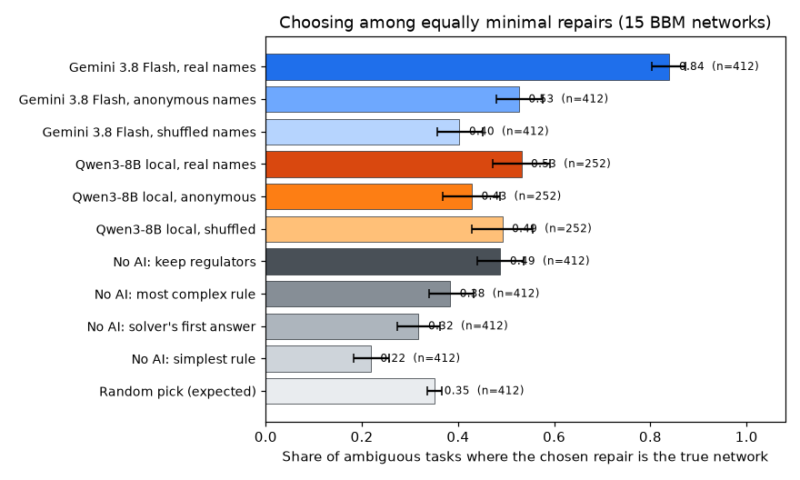
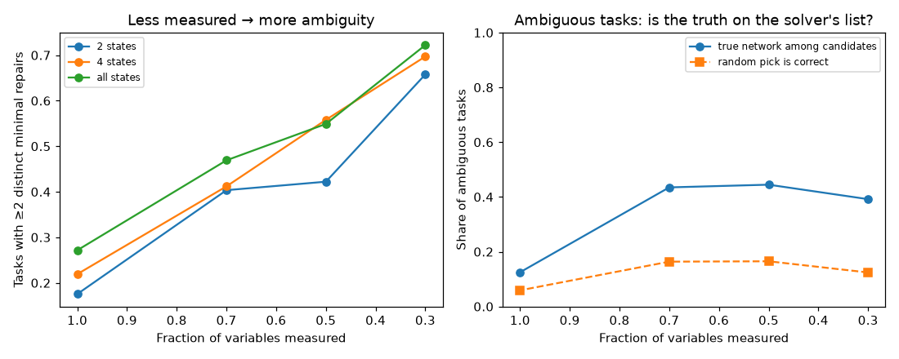

# Can a language model pick the right repair? Knowledge-guided revision of Boolean network models

When a logical model of a gene-regulatory or signalling network contradicts experimental data, a
logic solver can list every *minimal* way to fix it. Often several fixes fit the data equally well,
and the solver has no reason to prefer one. A biologist would choose using what is known about the
molecules involved. **This project tests whether a large language model can make that choice, and
whether it does so because of biological knowledge or because of something else.**

Status: **stages 0–2 complete, stages 3a and 3b in progress** (benchmark, solver pipeline, language-model choosers). Stage 3 (models
written from scratch, then repaired) is planned.

## Key results

On **412 ambiguous repair tasks from 15 published Boolean networks**, each with 2–30 equally minimal
repairs of which one is the true network:

| Chooser | Picks the true network | 95% CI |
| --- | --- | --- |
| **Gemini 3.8 Flash, real gene names** | **0.84** | 0.80–0.87 |
| Gemini 3.8 Flash, names replaced by g1, g2, … | 0.53 | 0.48–0.58 |
| Gemini 3.8 Flash, real names shuffled between nodes | 0.40 | 0.36–0.45 |
| Qwen3-8B on a laptop, real names | 0.52 | 0.47–0.57 |
| Best rule without AI ("keep the starting model's regulators") | 0.49 | 0.44–0.54 |
| Random pick (expected) | 0.35 | 0.34–0.37 |

- **Biological knowledge is doing the work.** With real names Gemini is right 84% of the time, 35
  points above the best knowledge-free rule (paired difference +0.35, 95% CI 0.29–0.41). With
  anonymous names it falls to the level of that rule (+0.04, CI −0.03 to 0.11).
- **Wrong knowledge hurts.** Shuffling the real names between nodes, so that biology points the
  wrong way, puts Gemini *below* the anonymous condition (−0.12, CI −0.18 to −0.07).
- **The result is not one network.** Gemini with real names matches or beats the best
  knowledge-free rule on 14 of 15 networks (`results/stage2_by_network.csv`).
- **A small local model gets little of this.** Qwen3-8B with real names (0.52) is no better than the
  best knowledge-free rule (+0.03, CI −0.03 to 0.10) and only a little better than with anonymous names
  (+0.07, CI 0.01–0.12); shuffling the names barely changes it. The solver supplies the guarantee that
  every option fits the data, but the biological judgement has to come from a strong model.
- Total Gemini API cost: **$7.47** for 1,344 calls, pilots included (0.66 M input, 1.86 M output tokens, most of it the model's thinking).



## Why the question is open

Model-revision tools such as ModRev / [pyModRev](https://github.com/ptgm/pymodrev) return all
minimal repairs and leave the choice to the modeller. LLMs have been used to generate signalling
networks in one shot (Benchmarking biochemical networks generated by LLMs, eLife reviewed preprint
109709) and to supply priors for network inference, and solver-in-the-loop LLM systems exist in other
fields. I did not find work that uses an LLM to choose among a solver's minimal repairs of a Boolean
biological model; the search was not exhaustive.

## How a task is built

1. **Truth.** A published, curated Boolean network from the
   [Biodivine Boolean Models](https://github.com/sybila/biodivine-boolean-models) collection (BBM).
   15 networks with 11–21 variables, monotone rules and at least 3 steady states.
2. **Data.** The truth's steady states (fixed points). Each task observes 2 or 4 of them, and in each
   only 70%, 50% or 30% of the variables, as an experiment that does not measure everything would.
3. **Error.** One rule of the truth is corrupted: an activation turned into an inhibition (or the
   reverse), or an AND turned into an OR (or the reverse).
4. **Repair.** pyModRev (clingo underneath) lists every minimal repair consistent with the data.
   Repairs that are the same Boolean function written differently are merged.
5. **Question.** Tasks with 2–30 distinct repairs, one of them the truth, go to the choosers. The
   options are shown in random order; the rest of the model is shown as context.

## Choosers compared

| Chooser | What it uses |
| --- | --- |
| Gemini 3.8 Flash (API) and Qwen3-8B (4-bit, run locally with MLX on an M4 Mac mini) | the model, the options, and node names in three versions: **real**, **anonymous** (g1, g2, …), **shuffled** (real names permuted between nodes) |
| Keep regulators | prefers options that do not turn a node into a free input and that keep the regulators of the starting rule |
| Most complex / simplest rule | number of literals in the disputed rules |
| Closest to start | smallest change in behaviour from the corrupted rule |
| Solver's first answer | pyModRev's output order |
| Random | expected accuracy, computed exactly |

The anonymous and shuffled conditions are the controls: the network and the options are identical,
only the labels change.

## What else the benchmark shows

| Variables measured | Tasks with ≥2 distinct minimal repairs | True network among the minimal repairs (all solved tasks) |
| --- | --- | --- |
| 100% | 18–27% | 64–67% |
| 70% | 40–47% | 56–63% |
| 50% | 42–56% | 53–57% |
| 30% | 66–72% | 39–44% |

(`results/stage1_table.csv`, 4,800 trials.)

- **Less measurement means more ambiguity**, which is where a chooser matters.
- **Minimal is often not true.** Even with every variable measured, the minimal repair is the true
  rule only about two times in three: steady states constrain a rule only at a few input
  combinations, so different rules fit them. In ambiguous tasks the truth is on the solver's list less
  than half the time. No chooser can fix that; it limits the whole approach and motivates stage 3.
- Many corruptions do not change any steady state and are invisible to this kind of data (15–65% of
  trials, depending on how much is measured).



## Stage 3a (in progress): errors that add or remove a regulator

The Stage 1–2 benchmark only flips signs or swaps AND/OR, which favours "keep the regulators".
Two new corruptions address that bias: **del_reg** fixes one regulator of a rule to a constant (the
rule no longer depends on it) and **add_reg** joins a spurious signed regulator by AND or OR. Both keep
rules monotone and never remove a variable from the network; the default corruptions are unchanged
byte for byte. Stage 1 was rerun on the same 15 networks and data levels (2 or 4 steady states;
70/50/30% measured; 20 seeds each; `results/stage1_regcorrupt_*.csv`), compared with the original
corruptions at the same levels (`scripts/stage3a_compare.py`, `results/stage3a_corruption_comparison.csv`):

| Corruption | Trials | Undetected by the data | Solved | True network among the minimal repairs (solved) | Usable Stage 2 tasks |
| --- | --- | --- | --- | --- | --- |
| Flip a sign (original) | 2,548 | 36% | 1,467 | 52% | 305 |
| AND ↔ OR (original) | 1,532 | 60% | 510 | 54% | 107 |
| **Remove a regulator** | 693 | 83% | 103 | **32%** | 33 |
| **Add a spurious regulator** | 1,107 | 66% | 314 | **1%** (4 of 314) | 4 |

- **pyModRev's minimal repairs almost never undo an added regulator.** In 310 of 314 solved tasks the
  true network is not among the minimal repairs, so no chooser, language model or not, can pick it.
  The solver finds cheaper fixes that fit the data while keeping the spurious edge. Removed regulators
  are restored somewhat more often (32%), still below the original corruptions (52–54%).
- **The data rarely reveal these errors.** 66–83% of the corrupted models still fit the observed
  steady states, compared with 36–60% for the original corruptions.
- **Consequence for the design.** Only 37 tasks (4 + 33) meet the Stage 2 criteria (2–30 repairs, truth
  among them), too few for a separate comparison. Repairs of this kind need a method that is not
  restricted to the solver's minimal repairs, which is what Stage 3b (the language model edits rules
  itself, the solver only checks them) will test.
- Not yet done: the reason behind the 1% (which repair costs pyModRev prefers) is not analysed; one
  error per task; the Stage 2 choosers have not been run on these tasks.

## Stage 3b (in progress): the language model repairs the model itself

Stage 3a showed that for an **added** regulator the true network is almost never among pyModRev's minimal
repairs, so no chooser can win. Stage 3b drops the candidate list: the model sees the corrupted network and the
partial steady-state measurements, is told that one rule is wrong (not which one) and returns corrected rules
(`src/repairer.py`). "Alone" scores its first answer. "Checked" lets the solver's role shrink to checking: if the
corrected model contradicts the measurements (exact enumeration of steady states), the model is told which
measured states fail and answers again, up to 3 answers. Names are real or anonymous, as in Stage 2.

Three models, on the same 112 tasks, both name conditions (77 added-regulator, 25 removed-regulator and 10
original Stage 2 tasks; `scripts/stage3b_run.py`, `scripts/stage3b_analyze.py`, `results/stage3b_*.csv`).
Accuracy = the final answer reproduces the true network exactly; 95% bootstrap CIs over tasks.

| Tasks | Truth among solver's minimal repairs | Gemini 3.8 Flash named / anon | DeepSeek V4.1 Flash named / anon | GPT-6-Luna named / anon |
| --- | --- | --- | --- | --- |
| Added regulator (77) | 0.05 | **0.81** / 0.42 | 0.43 / 0.16 | 0.44 / 0.34 |
| Removed regulator (25) | 0.20 | 0.36 / 0.04 | 0.36 / 0.04 | 0.12 / 0.00 |
| Original (10) | 1.00 | 1.00 / 0.80 | 0.80 / 0.90 | 0.30 / 0.40 |

("Checked" accuracy. CIs, first-answer accuracy, consistency and rounds: `results/stage3b_table.csv`.)

- **Language models repair what the minimal-repair principle cannot.** On added-regulator tasks, where the truth
  is among the solver's repairs in 5% of tasks, every model with real names does better: Gemini by +0.75
  (95% CI 0.66-0.84), DeepSeek +0.38 (0.26-0.48), GPT-6-Luna +0.39 (0.29-0.51) (`results/stage3b_paired.csv`).
- **Biological knowledge again carries the effect, for the two API models.** Real names minus anonymous names
  over all 112 tasks: Gemini +0.36 (0.24-0.47), DeepSeek +0.25 (0.16-0.35); GPT-6-Luna +0.09 (-0.04 to 0.22),
  not separable from zero.
- **Models differ a lot.** Gemini with real names beats DeepSeek by +0.28 (0.18-0.38) and GPT-6-Luna by +0.37
  (0.25-0.48). GPT-6-Luna's corrected models often still contradicted the data after three answers (consistent
  in 40-74% of tasks, against 88-100% for the other two), and it left the corrupted rule untouched in 36-43%.
- Removed regulators remain hard (at most 0.36), and the 10 original tasks are too few for a conclusion.

**One model on all tasks: GPT-6-Luna (Codex CLI)** (`scripts/stage3b_luna_full.py`,
`results/stage3b_luna_full.csv`). Every solved Stage 3a task (314 added, 103 removed regulator) and 151 sampled
original Stage 2 tasks, both name conditions; "checked" accuracy. Kept apart from the paired table above.

| Tasks | Truth among solver's minimal repairs | GPT-6-Luna named | anonymous |
| --- | --- | --- | --- |
| Added regulator (314) | 0.01 | 0.44 (0.39-0.50) | 0.34 (0.29-0.39) |
| Removed regulator (103) | 0.32 | 0.11 (0.05-0.17) | 0.04 (0.01-0.08) |
| Original (151) | 1.00 | 0.36 (0.28-0.44) | 0.29 (0.21-0.36) |

- On added regulators the model beats the solver's ceiling by +0.43 (0.37-0.48), as on the 112 paired tasks.
- On removed regulators it is **below** the solver's ceiling (-0.21, -0.31 to -0.12), and on the original
  tasks, where the truth is always among the solver's repairs, repairing alone (0.36) is far below picking from
  the solver's list (Gemini, Stage 2: 0.84). Free repair is not a replacement for the solver; it helps where the
  minimal-change principle is blind.
- Real minus anonymous names over 568 tasks: +0.09 (0.04-0.14), smaller than for Gemini and DeepSeek above.
- Repeatability: 143 (task, condition) pairs were answered twice after a restart; the outcome (right or wrong)
  agreed in 99 (69%), with 42 vs 48 correct (`results/stage3b_luna_repeat.csv`). Codex runs are noticeably
  non-deterministic, so single-answer accuracies carry this extra noise.

**Limits of Stage 3b (read before using these numbers).**
- Only 112 tasks: the Gemini run stopped when the paid API credit ran out (HTTP 402); the other models were run
  on exactly the tasks Gemini finished. The 10 original tasks are the pilot sample. One answer chain per task.
- The models are not reached in the same way. Gemini and DeepSeek through their APIs at temperature 0 (output
  limit 8,192 tokens for Gemini, 32,768 for DeepSeek because its reasoning counts against the limit and 8,192
  truncated 28 of 64 pilot answers). GPT-6-Luna through the Codex CLI signed in with a ChatGPT plan: Codex adds
  its own agent instructions (about 20k input tokens per call) and does not expose temperature; web search, apps
  and browser were disabled (a first test with web search on looked up a paper), the sandbox was read-only, user
  configuration ignored (`src/llm.py`).
- The consistency check fixes a measured input that a correction removes from the network as unconstrained.
- As in Stage 2, the networks are published and may have been seen in training.

## Stage 3 checks: same-model comparison, a database baseline, counterfactual networks (in progress)

**GPT-6-Luna as a Stage 2 chooser** (412 tasks, `scripts/stage2_luna.py`, `results/stage2_luna.csv`). Picking
among the solver's repairs: real names 0.51 (0.46-0.56), anonymous 0.27 (6.6% of anonymous answers could not be
read and count as wrong), shuffled 0.39. Real minus anonymous +0.25 (0.18-0.31), but real names are only level
with the best knowledge-free rule (+0.02, -0.04 to 0.09) and 0.33 below Gemini.

**Picking vs repairing within one model** (`results/stage3b_pick_vs_repair_luna.csv`). On the 151 original tasks
that ran in both stages, GPT-6-Luna picking from the solver's list scores 0.53 with real names; repairing by
itself scores 0.36 after checking, -0.17 (-0.28 to -0.06). The earlier conclusion (free repair complements the
solver rather than replacing it) therefore also holds inside one model, not only across models.

**A knowledge base without a language model** (`scripts/stage2_db_baseline.py`, `results/stage2_db_baseline.csv`).
Candidates are scored against OmniPath's directed, signed interactions (human and mouse): +1 for each regulator
OmniPath supports with the same sign, -1 for an opposite sign, -1 for each OmniPath edge into the node that the
rule leaves out; ties are broken uniformly (exact expected accuracy).

| Tasks | n | OmniPath pick | Keep regulators | Gemini named | Gemini anonymous |
| --- | --- | --- | --- | --- | --- |
| All | 412 | 0.49 | 0.49 | 0.84 | 0.53 |
| Mammalian networks | 279 | 0.56 | 0.49 | 0.84 | 0.54 |
| OmniPath separates the candidates | 119 | **0.79** | 0.61 | **0.84** | 0.50 |

- **Where a curated database has the facts, it does about as well as Gemini**: on the 119 tasks OmniPath can
  decide, Gemini minus OmniPath is +0.05 (-0.05 to 0.15). Gemini's overall lead (+0.35, 0.31-0.40) comes mostly
  from coverage: OmniPath has nothing for the Drosophila, yeast, E. coli and lac-operon networks and maps only part
  of the mammalian ones. The covered tasks are concentrated in three networks (AML 65, hematopoiesis ageing 30,
  myeloid progenitors 15).
- Caveats: the variable-to-gene mapping (`ALIAS` in the script) was written by hand; the chicken network is mapped
  through human orthologs; OmniPath may contain the very papers these models were built from, so it shares the
  "known from the literature" advantage with the language model.

**Counterfactual networks** (`scripts/stage3c_counterfactual_build.py`, `scripts/stage3c_counterfactual_analyze.py`,
`results/stage3c_counterfactual.csv`). For 200 added-regulator tasks the truth is changed: one regulator in the
rule of another node u has its sign flipped, the measurements are regenerated from this counterfactual network,
and the same error as before is put into the target rule. Restoring u to its published rule is never needed by the
data. GPT-6-Luna, both name conditions:

| | Real names | Anonymous |
| --- | --- | --- |
| Correct (counterfactual truth recovered) | 0.45 (0.38-0.52) | 0.34 (0.28-0.41) |
| First answer changed u at all | 0.065 | 0.07 |
| First answer put u back to the published rule | 0.03 (0.01-0.06) | 0.015 (0.00-0.04) |
| Same model on the original task, correct | 0.475 | 0.36 |

- GPT-6-Luna almost never overrides the given model with the published rule (real minus anonymous names +0.015,
  -0.01 to 0.04), and accuracy on counterfactual tasks is close to the original tasks. This does **not** settle
  the memory question: GPT-6-Luna shows a weak name effect in the first place (Stage 3b), so the test is weak with
  this model; it should be repeated with Gemini. A revert would also not separate memory of the specific paper
  from general knowledge, since both point to the published sign.

## Limitations

- **Known benchmark bias.** All corruptions keep the set of regulators, so "keep the regulators" is
  favoured by construction. This is why it is the strongest knowledge-free rule and why anonymous
  Gemini beats random. The comparison that matters is real names versus this rule and versus
  anonymous names, which both can exploit. Corruptions that add or remove a regulation were added in
  Stage 3a; the solver rarely recovers the truth for them (see above), so they do not yet give a
  bias-free Stage 2 test.
- **Recall or reasoning?** The networks are published, and the model may have seen them. Real-name
  accuracy shows that biological knowledge is used, not whether it is general knowledge or memory of a
  specific paper. Networks published after the model's training cut-off would separate the two.
- Synthetic data: observations are exact steady states of the true model. Real data are noisy and
  include perturbations.
- One error per task, one model call per task at temperature 0, one prompt wording.
- Steady-state observations only; time series would constrain rules more.

## Reproduce

Apple-silicon Mac, [uv](https://github.com/astral-sh/uv), a Gemini API key.

```bash
./setup.sh                                   # Python env, pinned BBM, local model download (~4.5 GB)
echo "GEMINI_API_KEY=..." > .env             # never committed
.venv/bin/python scripts/survey_networks.py  # which BBM networks are usable
.venv/bin/python scripts/stage1_ambiguity.py --ids 100 174 208 237 278 --trials 20 --states 2 4 99 --coverage 1.0 0.7 0.5 0.3 --out results/stage1_5nets
.venv/bin/python scripts/stage1_ambiguity.py --ids 3 10 21 63 99 104 177 182 185 212 --trials 40 --states 2 4 --coverage 0.7 0.5 0.3 --out results/stage1_newnets
.venv/bin/python scripts/stage1_ambiguity.py --ids 100 174 208 237 278 --seed-start 20 --trials 40 --states 2 4 --coverage 0.7 0.5 0.3 --out results/stage1_moreseeds
.venv/bin/python -m mlx_lm server --model mlx-community/Qwen3-8B-4bit --port 8080 &
.venv/bin/python scripts/stage2_run.py --levels 2:0.7 2:0.5 2:0.3 4:0.7 4:0.5 4:0.3 --llm gemini:gemini-3.8-flash local:mlx-community/Qwen3-8B-4bit
.venv/bin/python scripts/analyze.py
# Stage 3a
.venv/bin/python scripts/stage1_ambiguity.py --ids 3 10 21 63 99 100 104 174 177 182 185 208 212 237 278 --trials 20 --states 2 4 --coverage 0.7 0.5 0.3 --kinds del_reg add_reg --tasks-dir data/tasks_reg --workers 8 --out results/stage1_regcorrupt
.venv/bin/python scripts/stage3a_compare.py
# Stage 3b (Gemini key in .env; DeepSeek key as DEEPSEEK_API_KEY; Codex CLI signed in with a ChatGPT plan)
.venv/bin/python scripts/stage3b_run.py --spec gemini:gemini-3.8-flash --sets reg orig --sample 150
.venv/bin/python scripts/stage3b_run.py --spec deepseek:deepseek-flash --same-tasks-as gemini:gemini-3.8-flash
.venv/bin/python scripts/stage3b_run.py --spec codex:gpt-6-luna --same-tasks-as gemini:gemini-3.8-flash --threads 2
.venv/bin/python scripts/stage3b_analyze.py
.venv/bin/python scripts/stage2_run.py --levels 2:0.7 2:0.5 2:0.3 4:0.7 4:0.5 4:0.3 --llm codex:gpt-6-luna --threads 6
.venv/bin/python scripts/stage2_luna.py
curl -o data/omnipath/interactions.tsv "https://omnipathdb.org/interactions?genesymbols=yes&fields=curation_effort,sources&organisms=9606,10090&datasets=omnipath,tf_target,kinaseextra,pathwayextra"
.venv/bin/python scripts/stage2_db_baseline.py
.venv/bin/python scripts/stage3c_counterfactual_build.py --n 200
.venv/bin/python scripts/stage3b_run.py --spec codex:gpt-6-luna --sets cf --threads 4
.venv/bin/python scripts/stage3c_counterfactual_analyze.py
```

Every model call (prompt, reply, token counts) is logged locally to `runs/llm_log.jsonl`.
`results/stage2_results.jsonl` holds one line per task and chooser, with the model's reply.

## Layout

- `src/bnet.py` Boolean networks: read/write, fixed points, truth tables, monotonicity
- `src/benchmark.py` corruptions, partial observations, pyModRev wrapper, duplicate merging, scoring
- `src/chooser.py` prompt and answer parsing for the language models; name conditions
- `src/heuristics.py` knowledge-free choosers
- `src/llm.py` one interface for Gemini and the local MLX server, with call logging
- `scripts/` survey, Stage 1, Stage 2, analysis; `results/` tables; `figures/`

## References

- Gouveia F., Lynce I., Monteiro P.T. (2020). ModRev — Model revision tool for Boolean logical models of
  biological regulatory networks. *CMSB 2020*. pyModRev: github.com/ptgm/pymodrev.
- Pastva S. et al. (2023). Repository of logically consistent real-world Boolean network models.
  bioRxiv 10.1101/2023.06.12.544361.
- Benchmarking biochemical networks generated by large language models. eLife reviewed preprint 109709.

BBM models remain the copyright of their authors and are downloaded by `setup.sh`, not redistributed
here. Code: MIT licence.
